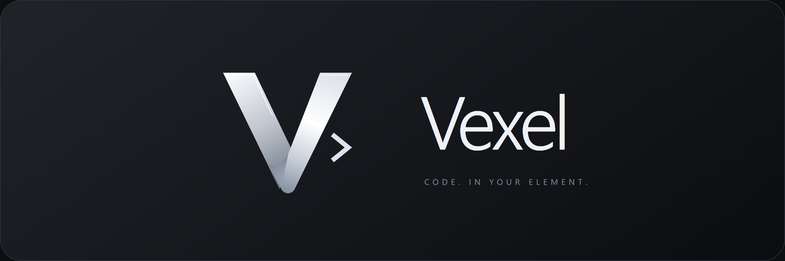

<p align="center"></p>

# Vexel 1.6

VS Code와 비슷한 화면 구성의 Windows용 데스크톱 코드 편집기입니다. 인터넷 연결 없이 로컬 파일을 편집할 수 있습니다.

## 설치

[Windows 설치 파일 다운로드](https://github.com/se01hxa/Vexel/releases/latest/download/Vexel-Setup-1.6.0.exe) · [모든 다운로드](https://github.com/se01hxa/Vexel/releases/latest)


**Vexel-Setup-1.6.0.exe**를 실행하면 설치 폴더, 바탕화면·시작 메뉴 바로가기, 소리, 코드 애니메이션, 토큰 보호와 선택 언어 설치를 설정할 수 있습니다. 언어 목록은 여러 항목을 클릭해 선택하며 기본값은 편집기만 설치입니다. 선택한 언어가 있으면 배포처와 WinGet 설치 약관 동의가 필요합니다. 일부 언어는 Windows 관리자 승인이 표시될 수 있습니다. 언어 하나의 설치가 실패해도 편집기는 설치되며, 앱의 **설정 → 언어 설치**에서 기록을 보고 다시 시도할 수 있습니다. 설치된 앱은 Windows의 설치된 앱에서 제거할 수 있습니다. 언어 실행기·SDK와 사용자 설정은 앱을 제거해도 보관합니다.

압축판은 설치 과정 없이 실행할 때 사용할 수 있습니다.

## 실행

Windows 배포 폴더 안의 **Vexel.exe**를 실행하세요. 배포 폴더의 나머지 파일도 함께 유지해야 합니다. 압축판은 전체를 풀고 실행하세요. 앱 자체에는 Node.js 설치가 필요하지 않습니다.

코드 실행에는 해당 언어의 실행기가 필요합니다. **설정 → 언어와 실행기**에서 PATH, SDK 환경 변수, 일반 설치 폴더, 패키지 관리자 경로를 자동으로 검사합니다. 새로 설치한 뒤에는 **다시 자동 확인**을 누르세요. 프로젝트의 `.venv` / `venv` Python도 감지합니다. `.ps1`은 설치된 PowerShell의 실행 정책을 따릅니다.

## 주요 기능

- **파일 열기**: Ctrl+O 또는 파일 메뉴에서 개별 파일을 선택합니다. 폴더를 먼저 열 필요가 없으며, 파일 모드의 탐색기에는 선택한 파일만 표시됩니다. 같은 작업 폴더에 있는 파일은 기존 탭에 추가됩니다. 다른 위치의 파일은 저장 여부를 확인한 뒤 파일 작업 공간으로 전환합니다.
- **코드 열기 효과**: 파일을 처음 열 때 코드가 차라락 작성되듯 나타납니다. 클릭·키 입력·스크롤로 즉시 끝낼 수 있습니다. 원본 내용과 저장 상태는 바뀌지 않습니다. 속도 조절·끄기를 지원하며 운영체제의 모션 줄이기 설정을 따릅니다.
- **7종 효과음**: 또각, 톡, 보송, 성공, 오류, 파일 열기, 차라락 타이핑. 앱을 위해 직접 합성한 소리이며 `assets/sounds`에 WAV 원본도 포함했습니다. 저장과 실행의 결과, 오류, 버튼 클릭, 파일 열기에 연결되어 있습니다. 조용한 자동 저장에는 성공음을 반복하지 않습니다. 설정에서 미리듣기·클릭음 선택·볼륨 조절·음소거가 가능합니다.
- **프로젝트 구조**: 폴더와 파일의 포함 관계, 코드에서 가져오는 모듈의 의존 관계, 함수와 클래스 목록을 표시합니다. 파일 이름이나 심볼을 클릭해 코드로 이동합니다. 확대·축소·이동·미니맵·파일 및 심볼 검색을 지원합니다.
- **테마**: Midnight, Graphite, Deep Ocean, Paper와 사용자 배경색·강조색. PNG/JPG/WebP/GIF 배경, 덮개 강도, 흐림 효과를 지원합니다. 설정은 자동으로 유지됩니다.
- **편집**: Monaco Editor, 여러 파일 탭, 구문 강조, 검색·바꾸기, 되돌리기, 들여쓰기, 미니맵, 줄 바꿈, 오류 목록, 함수 개요, 프로젝트 검색, 명령 팔레트.
- **자동 완성**: JS/TS의 타입 기반 IntelliSense와 프로젝트 내 파일 참조. 로컬 Python은 내장 Pyright의 완성·호버·진단. PowerShell은 명령어·스니펫·단어 제안입니다. 완성 목록은 Ctrl+Space로 열 수 있습니다.
- **SSH**: Linux/macOS SSH 서버의 폴더를 SFTP로 열고 편집·저장하며 SSH 터미널과 파일 실행을 사용합니다. 비밀번호 및 개인 키 인증, 서버 지문 확인을 지원합니다. 비밀번호와 키 암호는 저장하지 않습니다.
- **파일 실행**: 현재 파일을 저장한 뒤 F5로 실행합니다. Python, JS/TS, PowerShell, Kotlin, Java 등 아래 실행기 목록의 확장자를 지원합니다. 로컬 TypeScript 실행기는 내장 tsx를 사용하며 별도 tsx 설치는 필요하지 않습니다. 터미널은 실제 ConPTY이므로 표준 입력과 Ctrl+C를 지원합니다.
- **파일 관리**: 파일·폴더 만들기, 이름 변경, 로컬 파일 휴지통 이동. 변경된 탭과 편집 내용을 복구하고 외부 수정 시 저장 충돌을 감지합니다.

## Vexel AI · Codex / Claude / Antigravity + MCP

**Ctrl+Shift+L** 또는 왼쪽 반짝이 아이콘으로 AI 사이드바를 엽니다. 로컬 폴더를 열고 서비스를 고른 뒤 질문하세요. 현재 파일·선택 영역 첨부, 모델 지정, 스트리밍 답변, 대화 기록, 작업 중지와 수정안 비교를 지원합니다.

- **GPT · Codex**: 공식 Codex CLI의 app-server 프로토콜을 사용합니다. 기존 로그인 계정을 재사용하며 연결 탭에서 브라우저 로그인과 모델 목록 확인을 지원합니다. CLI가 필요합니다.
- **Claude**: 공식 Claude Code CLI의 stream-json 모드를 사용합니다. 연결 탭의 로그인 버튼으로 Vexel 터미널에서 공식 로그인 절차를 진행합니다. Claude 구독 또는 해당 CLI에서 지원하는 계정이 필요합니다.
- **Antigravity**: 공식 Antigravity CLI **agy**의 stream-json 모드로 연결합니다. IDE 실행 명령 antigravity나 Gemini CLI를 대신 실행하지 않습니다. CLI 설치 및 Google 로그인이 필요합니다. CLI가 없으면 설치 안내와 수동 실행 경로 지정을 사용하세요.

Antigravity의 무인 실행에서 MCP를 사용하려면 `~/.gemini/antigravity-cli/settings.json`의 `permissions.allow` 배열에 `"mcp(luma_code/*)"`를 추가하세요. 기존 설정을 유지하고 Vexel 도구만 허용하세요. 명시적인 deny/ask 정책이 있으면 allow보다 우선합니다. 앱은 전역 권한을 자동 변경하지 않습니다.

MCP 서버는 SDK 기반 stdio 프로토콜을 사용합니다. 앱 내장 런타임으로 실행하므로 외부 MCP 연결 자체에는 별도 Node.js가 필요하지 않습니다. 앱에서 실행한 에이전트에는 Vexel MCP를 자동으로 연결합니다. 외부 Codex / Claude / Antigravity에는 **연결 · MCP → 설정 복사**로 생성한 TOML 또는 JSON을 해당 도구의 MCP 설정에 추가하세요. 복사한 설정에는 실행 파일과 연결 파일 경로만 포함되며 인증 토큰은 출력하지 않습니다. Vexel를 열어두고, 앱 재설치 경로를 바꿨다면 MCP 설정을 다시 복사하세요.

도구: luma_workspace, luma_active_editor, luma_list_files, luma_read_file, luma_search, luma_diagnostics, luma_propose_change, luma_open_file. 선택 영역과 미저장 버퍼도 읽을 수 있고 첨부/MCP 결과의 알려진 민감한 값은 가립니다. MCP는 열린 작업 공간 범위를 검사하고 디렉터리 이탈·외부 심볼릭 링크·생성 폴더 접근을 차단합니다. stdio 프록시와 편집기 사이에는 임시 인증을 사용하는 로컬 루프백 연결을 사용합니다.

수정안은 즉시 파일을 덮어쓰지 않습니다. 변경 목록 → 차이 보기 → **수정안 적용**에서 반영합니다. 새 파일은 기존 폴더 안에 제안할 수 있습니다. 삭제와 새 폴더 생성은 이 버전의 MCP 도구에 포함하지 않습니다. 민감한 값이 있는 파일의 수정, 미저장 파일 덮어쓰기, 오래된 기준 내용의 덮어쓰기를 거부합니다. 질문 모드에서는 수정안 생성을 막습니다. 기본 제공 에이전트의 직접 쓰기를 제한하고 MCP 수정안 사용을 지시하지만 각 CLI의 자체 도구와 추가 명령 허용은 해당 CLI 권한 정책을 따릅니다. Codex의 추가 명령 요청은 사이드바에서 확인 후 한 번만 허용하거나 거절할 수 있습니다. Claude는 Vexel MCP 도구 중심으로 실행하고 Antigravity는 plan 모드에서 실행합니다.

AI 에이전트 대화는 로컬 작업 공간용입니다. SSH 작업 공간은 MCP 읽기·탐색 연결을 사용할 수 있으며 AI 수정안 적용은 지원하지 않습니다. 최근 대화 30개를 앱 사용자 데이터에 저장하고, 파일 첨부는 최대 512 KB, MCP 목록/검색과 대기 수정안 수에 제한을 둡니다. 서비스 이용 요금·사용 한도는 각 계정에 따릅니다. Vexel이 VS Code의 공식 확장 패키지를 그대로 실행하는 방식은 아닙니다.

공식 프로토콜: [Codex app-server](https://learn.chatgpt.com/docs/app-server), [Claude Code](https://code.claude.com/docs/en/headless), [Antigravity CLI](https://www.antigravity.google/docs/cli/headless/).

## Discord 활동 확장

설정 → Discord 활동에서 켜면 Application ID 1562471621191540817로 연결합니다. 별도 토큰이나 VS Code 확장 설치가 필요하지 않습니다. Vexel 로고, 프로젝트 폴더 이름, 파일 이름, 커서 줄·열, 마지막 수정 줄, 마우스가 가리키는 코드 줄·열을 표시합니다. 파일·프로젝트 이름만 보내며 전체 경로, 코드 본문, 토큰과 SSH 호스트는 보내지 않습니다. 각 항목을 끄거나 활동 자체를 끌 수 있습니다. 기본값은 꺼짐입니다.

.env 및 비밀 값이 감지된 파일은 기본적으로 파일·프로젝트·위치를 숨깁니다. 마우스가 편집기 밖에 있으면 편집기 밖으로 표시하며 화면 좌표는 추적하지 않습니다. Discord 제한에 맞춰 약 15초마다 최신 상태를 반영하고 5분간 위치 변화나 편집이 없으면 활동을 지웁니다. 다시 작업하면 복원됩니다. Discord 실행 후 자동 재연결하며 Canary·Vesktop 등 여러 클라이언트가 켜져 있으면 RPC 연결 번호를 선택할 수 있습니다. Discord의 활동 공유 옵션 및 Vesktop의 RPC 플러그인이 켜져 있어야 합니다. 활동 제목은 Discord Developer Portal의 앱 이름을 사용합니다.

## 토큰 보호

기본값은 **항상 가리기**입니다. .env와 .env.* 및 *.env 파일의 값을 ***로 표시합니다. 코드·설정 파일에서는 이름에 token, secret, password, api_key, 토큰, 비밀번호 등이 포함된 일반적인 할당문을 보호합니다. 원본 모델과 파일은 수정하지 않고, 해당 파일은 보호된 읽기 전용 미리보기로 표시합니다. 저장과 실행은 원문을 사용합니다. 값을 직접 편집하려면 화면공유를 멈추고 **설정 → 토큰 보호 → 가리지 않기**를 선택하세요.

자동 모드는 Discord, Discord Canary/PTB/Development, Vesktop, Vencord, Equicord, ArmCord, Legcord 프로세스가 실행 중이면 보호합니다. 타 앱의 실제 공유 시작·종료를 확정하는 기능은 아니며, 실행 여부를 약 2.5초마다 확인하는 보수적인 방식입니다. 감지 실패 시에도 보호합니다. 화면공유 시작 순간과 브라우저 기반 공유까지 보호하려면 항상 가리기를 유지하세요.

열린 파일과 코드 실행 전에 읽은 작업 폴더의 .env 값 중 알려진 원문(4~8192자)을 터미널에서도 가립니다. 여러 출력 조각으로 나뉜 토큰도 처리합니다. 보호를 켜면 이전 터미널 표시를 지웁니다. 토큰을 변환·인코딩·암호화한 출력, 임의의 로그 파일·외부 앱의 화면, 일반 문자열에 숨겨 놓은 모든 비밀까지 자동 식별하는 기능은 아닙니다.

## 언어 설치

**설정 → 언어 설치**에서 25개 패키지 유형을 선택해 설치하거나 최신 안정 버전으로 업데이트할 수 있습니다. 기존 언어 행의 버튼은 **최신 버전으로 업데이트**로 표시됩니다. WinGet 소스가 제공하는 최신 안정 패키지를 사용하며, Python·Java·.NET·Ruby·PHP·Groovy의 버전별 패키지 ID도 새로 검색합니다. Kotlin은 JetBrains 공식 GitHub 릴리스의 SHA-256을 확인해 사용자 SDK 폴더에 설치합니다. Kotlin·Scala·Groovy를 고르면 Java도 준비합니다. 설치가 끝나면 경로를 다시 검사합니다.

WinGet(Windows 앱 설치 관리자)이 없거나 인터넷·권한 문제로 설치에 실패하면 그 이유와 기록을 표시합니다. Haskell, Nim, OCaml은 별도 환경 초기화가 필요해 공식 설치 페이지를 연결합니다. Rust·Swift 등은 공급자가 요구하는 C++ 도구/Windows SDK가 추가로 필요할 수 있습니다. 여러 버전의 공존과 기존 버전 교체는 각 배포처의 설치 방식에 따릅니다.

Kotlin SDK는 %LOCALAPPDATA%\LumaCode\sdks에 버전별로 보관합니다. 다운로드는 공식 릴리스 해시 확인 후 게시하며 기존 SDK는 보관합니다.

## 언어와 실행기

- **자동 확인**: Python, JavaScript/TypeScript(Node.js), PowerShell, Kotlin, Java/JDK, C, C++, Rust, Go, C#/F#(.NET SDK), Ruby, PHP, Lua, Perl, R, Julia, Dart, Swift, Bash, Haskell, Nim, Zig, OCaml, Racket, Elixir, Groovy, Scala, Bun, Deno의 실행기를 검사합니다. 버전 명령의 성공 여부와 출력으로 확인하므로 파일 존재만으로 설치되었다고 표시하지 않습니다.
- **경로 직접 지정**: 언어 행을 펼쳐 실행 파일이나 설치 폴더를 입력하고 **검사 후 저장**을 누릅니다. 파일/폴더 선택 버튼도 사용할 수 있습니다. 전체 경로, `~`, `%JAVA_HOME%` 같은 환경 변수 경로를 지원합니다. 검사 실패 시 이전 설정을 유지합니다. **자동 감지로 복원**으로 수동 설정을 해제합니다.
- **Kotlin**: Kotlin/JVM의 kotlinc와 Java가 필요합니다. `.kt`는 컴파일 후 실행하고 `.kts`는 스크립트로 실행합니다. Java 경로에 JDK를 지정하면 같은 설치 폴더의 javac도 찾습니다. Java는 JDK 컴파일러가 함께 있어야 현재 소스 파일을 실행할 수 있습니다.
- **컴파일 언어**: C/C++(GCC 또는 Clang), Java, Kotlin, Rust, C# 등의 생성물은 임시 폴더에 보관하고 프로세스 종료 시 정리합니다. 기본 실행은 현재 파일 단위입니다. 여러 소스 파일, 외부 의존성, 프로젝트 빌드 설정은 터미널에서 해당 프로젝트 명령을 사용하세요.
- **목록 밖의 언어**: **실행기 추가**에서 이름, 확장자, 실행 파일, 실행 인수와 버전 인수를 등록합니다. 인수는 JSON 배열입니다. `["run", "{file}"]`처럼 파일 경로를 넣을 수 있고 `{dir}`, `{name}`도 지원합니다. 실행 파일의 버전 확인 명령이 성공하고 출력이 있어야 저장됩니다. 사용자 실행기는 같은 확장자의 기본 실행기보다 우선합니다. Bun/Deno를 기본 JS/TS 대신 사용하려면 이 방법으로 등록하세요.
- 자동 검색은 알려진 설치 위치를 대상으로 합니다. 모든 위치와 모든 언어를 완전히 자동 식별할 수는 없으므로, 누락된 실행기는 직접 지정하거나 사용자 실행기로 등록하세요. 설치가 필요한 경우 위 언어 설치 기능을 사용하세요.
- 이 화면은 로컬 컴퓨터용 설정입니다. SSH 작업 공간은 서버의 실행기를 사용하며 원격 F5 기본 지원은 Python, JS/TS, PowerShell, Bash입니다.

## 빠른 시작

1. **파일 열기**로 파일 하나를 열거나 **폴더 열기**에서 작업 폴더 또는 함께 제공된 `예제 프로젝트`를 선택합니다.
2. 처음 표시되는 프로젝트 구조를 살펴보고 파일 이름을 누릅니다.
3. 코드를 편집하고 Ctrl+S로 저장합니다. F5로 실행합니다.
4. 왼쪽 아래 설정 아이콘에서 테마와 배경을 바꿉니다. **효과와 소리**에서 코드 열기 애니메이션과 효과음을 설정합니다.
5. 원격 작업은 왼쪽 모니터 아이콘 → 새 연결에서 호스트·사용자·인증·원격 폴더를 입력합니다.

## 단축키

- Ctrl+O: 파일 열기
- Ctrl+Shift+O: 폴더 열기
- Ctrl+P: 파일 빠르게 열기
- Ctrl+Shift+P / Ctrl+K: 명령 팔레트
- Ctrl+S / Ctrl+Alt+S: 저장 / 모두 저장
- F5: 현재 파일 실행
- Ctrl+Space: 자동 완성 제안
- Ctrl+Shift+G: 프로젝트 구조
- Ctrl+Shift+F: 프로젝트 검색
- Ctrl+F / Ctrl+H: 현재 파일 찾기 / 바꾸기
- Ctrl+`: 터미널 표시·숨기기
- Ctrl+B: 사이드바 표시·숨기기
- Ctrl+,: 설정
- Ctrl+W: 현재 탭 닫기

## 범위와 제한

이 버전은 독립 편집기입니다. VS Code 확장 프로그램 호스트, 디버거, Git 변경 관리, AI 코딩 에이전트, 개발 컨테이너는 포함하지 않습니다. 원격 Python은 로컬 Pyright 대신 단어와 스니펫을 제안합니다. 원격 TypeScript 실행에는 서버의 tsx 또는 해당 TS 파일을 실행할 수 있는 Node.js가 필요합니다. SSH 에이전트·다단계 인증·ProxyJump·Windows SSH 서버는 지원 범위 밖입니다.

구조 분석은 JS/TS AST와 Python/PowerShell 등의 선언·import 패턴을 사용합니다. 동적 호출 그래프가 아니며, 런타임에서 만들어지는 의존 관계와 일부 사용자 정의 import 별칭은 생략될 수 있습니다. Python import 패턴 분석은 정적 패턴 기반입니다.

큰 작업 폴더에서는 탐색 항목 3,000개, 인덱스 650개 / 합계 18 MB, 텍스트 파일당 2 MB로 제한합니다. 구조도는 폴더 보기 최대 180개 노드, 의존 관계 보기 최대 160개 파일이며 검색으로 범위를 좁힐 수 있습니다. `.git`, `node_modules`, `.venv`, `dist` 등 생성 폴더와 심볼릭 링크는 탐색에서 제외합니다. 프로젝트 검색은 저장된 인덱스 대상 파일을 검색하며 최대 300개 결과를 표시합니다. 원격 파일 변경은 수동 새로 고침으로 반영합니다. UTF-8과 UTF-8 BOM을 지원하며 줄바꿈 형식을 유지합니다.

사용자 설정과 SSH 호스트 지문은 `%APPDATA%\luma-code\settings.json`, 탭·편집 복구 데이터는 앱의 로컬 저장소에 기록됩니다. 복구 데이터는 최근 상태를 주기적으로 보관하며 파일 저장을 대신하지 않습니다. 전송 데이터는 SSH를 사용하고 서버 지문은 처음 연결 시 확인합니다.

## 소스 개발

Node.js 22.12 이상에서 아래 명령을 사용하세요.

```sh
npm ci
npm run dev
npm run build
npm start
npm test
npm run test:app
npm run test:effects
npm run test:runtimes
npm run test:privacy
npm run package
```

언어 실행기 통합 검사에서 실제 Kotlin/Java를 확인하려면 LUMA_TEST_KOTLIN_ROOT와 LUMA_TEST_JAVA_ROOT에 테스트용 SDK 폴더를 지정하세요. 앱 통합 검사에는 Node.js, Python, PowerShell이 필요합니다. 특정 Python을 사용하려면 `LUMA_TEST_PYTHON` 환경 변수에 Python 실행 파일의 전체 경로를 지정하세요. 배포본을 검사하려면 `LUMA_TEST_EXECUTABLE`에 배포 실행 파일의 전체 경로를 지정할 수 있습니다. 앱 코드는 특정 사용자 경로에 의존하지 않습니다. 실행, 언어 서버, 파일 저장, 구조도, 테마, 복구, SSH/SFTP는 통합 검사 대상입니다. SSH 검사는 로컬 임시 SSH 서버를 사용합니다.

Electron, Monaco Editor, Pyright, React, xterm.js, ssh2, node-pty, React Flow 등 오픈소스 구성 요소를 사용합니다. 배포본에는 라이선스 고지를 함께 제공합니다.

## Vexel 로고와 이름 변경

Velora의 은색 리본 감각을 참고해 Vexel 전용 각진 V와 코드 꺾쇠를 벡터로 제작했습니다. 원본은 assets/vexel-mark.svg, Windows 아이콘은 assets/icon.ico입니다.

기존 설정·SSH·AI 대화를 이어 쓰도록 사용자 데이터 폴더 luma-code, 앱 ID, luma_* MCP 도구와 서버 식별자는 호환 목적으로 유지합니다. 이름 변경 후 MCP 연결 화면에서 새 실행 경로를 복사하세요. Discord Application ID의 포털 이름은 계정에서 Vexel로 변경해야 활동 제목에도 새 이름이 표시됩니다.
